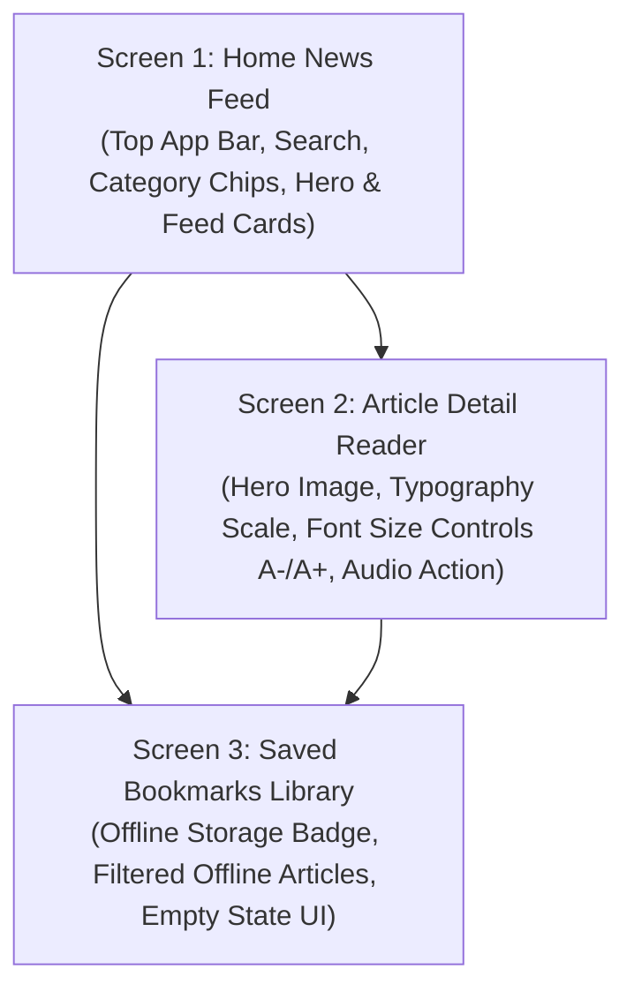

# Redesign Proposal: Gazzette Plus Ethiopian News App

## 1. Problem Statement

Based on our critique of the **Gazzette Plus** mobile app and the inherited wireframe (`gazzetteplus.drawio.png`), the current design suffers from key UX and UI limitations:
1. **Low Accessibility & Small Touch Targets:** Touch targets in navigation and action bars are under 32dp, violating the **48dp minimum touch target** rule.
2. **Network Vulnerability:** No dedicated offline caching or saved library feature to support Ethiopian users facing unstable mobile network coverage or data budget limits.
3. **Sub-optimal Reading Experience:** Lack of font size controls, reader view customization, or outdoor high-contrast themes for reading in direct sunlight.
4. **Search & Discovery Friction:** Search is hidden behind a small category bar icon, requiring 3+ taps to perform a news search.

---

## 2. Proposed Solution & Core Workflow Scope

We propose a complete redesign and rebuild of **Gazzette Plus** using **Android Material 3 XML Layouts**. The redesign focuses on a tightly integrated **3-Screen Core Reading Workflow**:

### Screen 1: Home News Feed (`activity_main.xml`)
* **Top App Bar:** Integrated **Gazzette Plus** branding, quick search action bar, and offline connection status pill.
* **Filter Chips:** Scrollable Material 3 `ChipGroup` (`All`, `Ethiopia`, `Top Stories`, `Deep Dive`, `Tech`) with 48dp touch heights.
* **Hero News Card:** Highlighted breaking/top story card with category badge, large thumbnail, title, and timestamp.
* **Article List Feed:** Scrollable list of news article item cards using `item_article_card.xml`.

### Screen 2: Article Detail Reader (`activity_article_detail.xml`)
* **Header & Metadata:** Full-width hero banner image, title, author attribution, publication timestamp, and reading duration tag.
* **Reader Controls Bar:** Quick action bar with **Font Sizing Controls (`A-` / `A+`)**, Audio Listen action button, Share action, and Bookmark button.
* **Legibility-Optimized Body Text:** High-contrast text layout supporting sunlight readability.

### Screen 3: Saved Offline Bookmarks (`activity_bookmarks.xml`)
* **Offline Library Header:** Storage usage badge showing saved article count and memory footprint.
* **Cached Article Feed:** List of downloaded news articles accessible even when device Wi-Fi/Mobile Data is disabled.
* **Empty State Layout:** Friendly empty state with illustration, title, description, and "Browse News" action button when no articles are saved.

---

## 3. Expected Impact

| Metric / Feature | Previous Design | Proposed Material 3 XML Rebuild |
| :--- | :--- | :--- |
| **Touch Target Size** | ~30dp (Fails Accessibility) | **≥48dp × 48dp** (WCAG 2.1 / Android Compliant) |
| **Search Access Taps** | 3 Taps | **1 Tap** (Direct search bar in top app bar) |
| **Offline Reliability** | 0% (Fails without data) | **100% Cached Bookmarks Library** |
| **Reading Customization** | None | **Live Reader Font Resizing Controls** |
| **Outdoor Readability** | Low contrast white/gray | **High Contrast Light/Dark DayNight Tokens** |

---

## 4. Technical Implementation Plan (XML Architecture)

* **Layout Files:**
  * `app/src/main/res/layout/activity_main.xml`
  * `app/src/main/res/layout/activity_article_detail.xml`
  * `app/src/main/res/layout/activity_bookmarks.xml`
  * `app/src/main/res/layout/item_article_card.xml`
* **Resource Declarations:**
  * `res/values/colors.xml`: Primary brand deep crimson `#B71C1C`, surface tones, badge background colors.
  * `res/values/dimens.xml`: Min 48dp touch targets, card elevation (4dp/8dp), margins, text sizes.
  * `res/values/strings.xml`: Externalized UI strings and accessibility descriptions.
  * `res/values/themes.xml`: Material 3 DayNight theme definitions (`Theme.Material3.DayNight.NoActionBar`).
